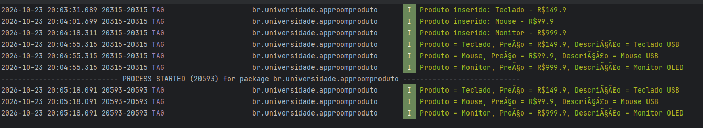
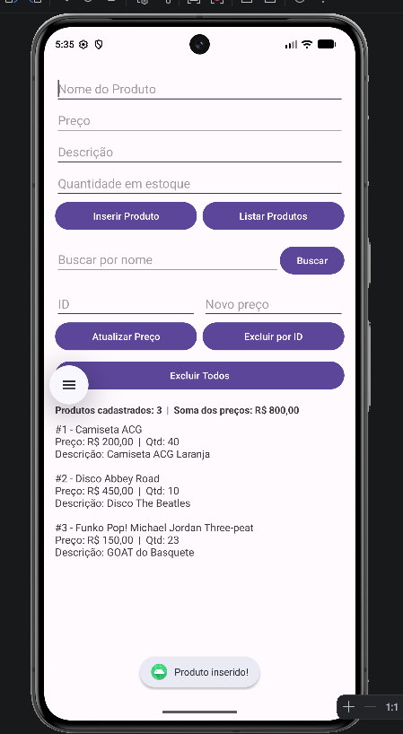
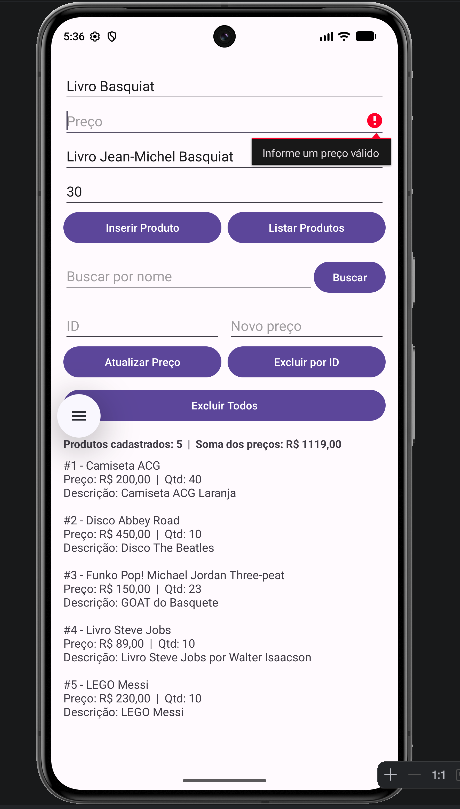
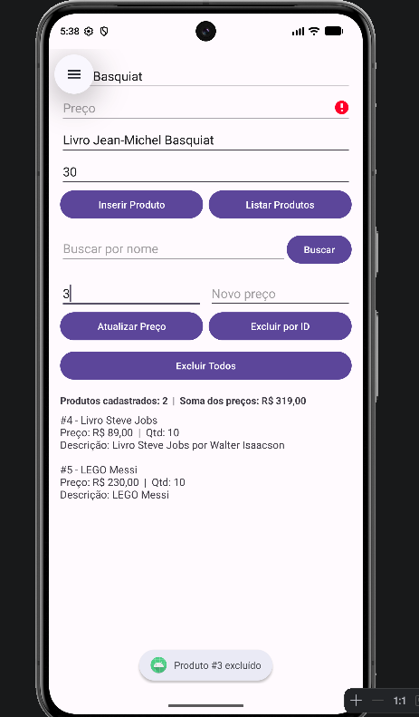

# AppRoomProduto: Cadastro de Produtos com Room SQLite

**Aluno(a):** Cauê Santos Gonçalves da Silva | Henrique Azevedo Ferreira
**RA:** 225477 | 214702
**Disciplina:** Programação para Dispositivos Móveis
**Professor(a):** ALESSANDRO FERREIRA PAZ LIMA

## Sobre o projeto

Aplicativo Android em Kotlin que cadastra, lista, busca, atualiza e exclui produtos
usando persistência local com Room (SQLite). Os dados continuam salvos depois de fechar o app.

## Tecnologias

- Kotlin
- Room 2.6.1 (SQLite)
- ViewBinding
- Corrotinas (lifecycleScope)

## Estrutura

```
app/src/main/
├── java/br/universidade/approomproduto/
│   ├── model/Product.kt        ← tabela (Entidade)
│   ├── dao/ProductDao.kt       ← comandos SQL (DAO)
│   ├── db/AppDatabase.kt       ← o banco de dados
│   └── view/MainActivity.kt    ← a tela
├── res/layout/activity_main.xml
└── AndroidManifest.xml
```

## Prints do app




---

# Parte A: Complemento prático

## A1. Limpar campos após inserir

**O que foi feito:**

Fiz uma função chamada `limparCampos()` para limpar todos os campos depois que um produto é cadastrado com sucesso. Também coloquei o cursor de volta no campo Nome para facilitar o cadastro de outro produto.

Chamei essa função depois de salvar o produto no banco, assim os campos só são limpos quando a operação termina.

```kotlin
private fun limparCampos() {
    binding.editProductName.text.clear()
    binding.editProductPrice.text.clear()
    binding.editProductDescription.text.clear()
    binding.editProductQuantity.text.clear()
    binding.editProductName.requestFocus()
}
```

**Print:**



## A2. Validação de preço

**O que foi feito:**

Adicionei uma validação para impedir que o usuário cadastre produtos com preços inválidos. Utilizei `toDoubleOrNull()` para converter o valor digitado em número.

Se o campo estiver vazio, tiver um valor inválido ou o preço for menor ou igual a zero, o aplicativo mostra uma mensagem de erro e não salva o produto.

```kotlin
val price = priceText.toDoubleOrNull()

if (price == null || price <= 0.0) {
    binding.editProductPrice.error = "Informe um preço válido"
    binding.editProductPrice.requestFocus()
    return
}
```

**Print:**


## A3. Lista na tela

**O que foi feito:**

Antes, os produtos eram exibidos apenas no Logcat. Para melhorar isso, adicionei um `TextView` chamado `txtListaProdutos` abaixo dos botões.

Agora, quando clico em **Listar Produtos**, os dados continuam aparecendo no Logcat, mas também são exibidos na própria tela. A lista mostra o ID, o nome, o preço, a quantidade e a descrição de cada produto.

```kotlin
binding.txtListaProdutos.text = products.joinToString("\n\n") {
    "#${it.id} - ${it.name}\n" +
        "Preço: ${formatarReais(it.price)}  |  Qtd: ${it.quantity}\n" +
        "Descrição: ${it.description.orEmpty().ifEmpty { "-" }}"
}
```

**Print:**



## A4. Total do estoque

**O que foi feito:**

Adicionei um resumo acima da lista de produtos. Ele mostra quantos produtos estão cadastrados e a soma dos preços registrados.

Para calcular essas informações, utilizei `products.size` para contar os produtos e `sumOf` para somar os preços. O resultado é formatado em reais.

```kotlin
val total = products.sumOf { it.price }

binding.txtResumo.text =
    "Produtos cadastrados: ${products.size}  |  Soma dos preços: ${formatarReais(total)}"
```

**Print:**


## A5. Buscar por nome

**O que foi feito:**

Adicionei um campo de busca e um botão chamado **Buscar**, além de uma função no DAO para pesquisar os produtos pelo nome.

A busca funciona mesmo quando o usuário digita apenas uma parte do nome. Por exemplo, ao pesquisar por "tec", o aplicativo consegue encontrar um produto chamado "Teclado".

Para isso, utilizei o comando SQL `LIKE` com o caractere `%`, que permite encontrar nomes que contenham o texto pesquisado.

```kotlin
// DAO
@Query("SELECT * FROM product WHERE name LIKE :nome")
suspend fun buscarPorNome(nome: String): List<Product>

// MainActivity
val resultado = productDao.buscarPorNome("%$texto%")
mostrarNaTela(resultado)
```

**Print:**


## A6. Excluir produtos

**O que foi feito:**

Implementei a opção de excluir todos os produtos cadastrados por meio do botão **Excluir Todos**.

Também fiz a exclusão de um produto específico como desafio extra. Nesse caso, o aplicativo procura o produto pelo ID e, se ele existir, realiza a exclusão.

```kotlin
// DAO
@Query("DELETE FROM product")
suspend fun deleteAll()

@Delete
suspend fun delete(product: Product)

@Query("SELECT * FROM product WHERE id = :id")
suspend fun getById(id: Int): Product?

// MainActivity (excluir por ID)
val product = productDao.getById(id)

if (product != null) {
    productDao.delete(product)
}
```

**Print:**



## A7. Atualizar produto

**O que foi feito:**

Adicionei a opção de atualizar o preço de um produto. Para isso, o usuário informa o ID do produto e o novo preço e clica em **Atualizar Preço**.

O aplicativo procura o produto pelo ID e, caso ele exista, cria uma cópia com o novo preço usando `copy()`. Depois, utiliza o `@Update` do Room para salvar a alteração no banco de dados.

```kotlin
// DAO
@Update
suspend fun update(product: Product)

// MainActivity
val product = productDao.getById(id)

if (product != null) {
    productDao.update(product.copy(price = novoPreco))
}
```

**Print:**


## A8. Novo campo na tabela (quantity)

**O que foi feito:**

Adicionei o campo `quantity` à classe `Product` para armazenar a quantidade de cada produto em estoque. Também incluí o campo correspondente na tela e alterei a versão do banco de dados de 1 para 2.

```kotlin
@Entity
data class Product(
    @PrimaryKey(autoGenerate = true) val id: Int = 0,
    @ColumnInfo(name = "name") val name: String,
    @ColumnInfo(name = "price") val price: Double,
    @ColumnInfo(name = "description") val description: String?,
    @ColumnInfo(name = "quantity") val quantity: Int = 0
)

@Database(entities = [Product::class], version = 2)
abstract class AppDatabase : RoomDatabase() { ... }
```

**O que aconteceu com os produtos que já estavam cadastrados?**

Os produtos cadastrados anteriormente foram apagados. Isso aconteceu porque o banco antigo estava na versão 1 e não tinha a coluna `quantity`.

Como não configurei uma migração para passar da versão 1 para a 2, o `fallbackToDestructiveMigration()` apagou o banco antigo e criou outro com a nova estrutura.

Durante o desenvolvimento, isso facilita as alterações, mas não seria uma boa solução para um aplicativo já publicado, pois os usuários poderiam perder seus dados ao atualizar o app.

Para evitar isso, poderia criar uma `Migration` para adicionar a nova coluna sem apagar os produtos existentes. O comando SQL seria:

```sql
ALTER TABLE product
ADD COLUMN quantity INTEGER NOT NULL DEFAULT 0;
```

**Print:**


---

## Parte B: Questões dissertativas

### B1. O que é persistência de dados? O que aconteceria se os produtos ficassem só em uma MutableList na MainActivity?

**Resposta:** Persistência de dados é a capacidade de guardar informações de modo que elas continuem existindo depois que o programa é fechado, o celular é reiniciado ou o sistema encerra o processo. Em vez de ficar apenas na memória RAM, o dado é gravado em um armazenamento permanente, como o arquivo `database-name` que o Room cria no armazenamento interno do app. Se os produtos estivessem só em uma `MutableList` dentro da `MainActivity`, eles viveriam apenas na memória enquanto a Activity existisse. Bastaria fechar o app, o Android matar o processo para liberar memória ou até girar a tela (a Activity é recriada) para a lista voltar vazia e todos os cadastros serem perdidos. No meu projeto, o `productDao.insertAll(product)` grava o produto no arquivo do banco, e por isso, depois de fechar e abrir o app, o botão Listar Produtos ainda mostra tudo que foi cadastrado.

### B2. Qual é a diferença entre usar o SQLite diretamente e usar o Room? Cite pelo menos duas vantagens do Room.

**Resposta:** Com o SQLite puro é preciso criar uma classe que herda de `SQLiteOpenHelper`, escrever à mão o `CREATE TABLE` em uma string, tratar `onUpgrade`, montar `ContentValues` para inserir e percorrer um `Cursor` coluna por coluna para transformar cada linha em um objeto. Tudo isso é muito código repetitivo, e um erro de digitação em uma consulta SQL só aparece quando o app está rodando. O Room é uma camada sobre o SQLite que faz esse trabalho por mim: eu descrevo a tabela com uma classe anotada com `@Entity` e os comandos com `@Dao`, e ele gera o código na compilação. Entre as vantagens estão: (1) as consultas `@Query` são verificadas em tempo de compilação, então um nome de tabela ou coluna errado impede o build em vez de derrubar o app; (2) a conversão entre linha do banco e objeto Kotlin é automática, o que reduz muito o código; (3) ele se integra com corrotinas (`suspend`), Flow e LiveData e avisa quando algum acesso é feito na thread principal; (4) tem suporte a migrações de versão.

### B3. Explique o papel de Entity, DAO e Database e como se relacionam no projeto.

**Resposta:** A **Entity** é a classe que representa a tabela. No projeto, `Product` é anotada com `@Entity`, cada atributo (`id`, `name`, `price`, `description`, `quantity`) vira uma coluna e cada objeto criado vira uma linha. O **DAO** (Data Access Object) é a interface onde ficam as operações que posso fazer com os dados: no projeto, `ProductDao` tem `getAll`, `buscarPorNome`, `insertAll`, `update`, `delete` e `deleteAll`, e o Room escreve a implementação delas. O **Database** é a classe abstrata `AppDatabase`, anotada com `@Database`, que junta as peças: ela lista as entidades (`entities = [Product::class]`), define a versão e expõe o DAO pela função `productDao()`. A relação é: o `AppDatabase` conhece a entidade e entrega o DAO; a `MainActivity` constrói o banco com `Room.databaseBuilder`, pega o DAO com `db.productDao()` e usa esse DAO para gravar e ler objetos `Product`.

### B4. Por que o Android não permite acessar o banco na thread principal? O que é ANR? Como suspend e lifecycleScope.launch resolvem?

**Resposta:** A thread principal (UI thread) é a que desenha a tela e responde aos toques do usuário. Ler ou gravar em disco pode ser lento, e se isso acontecer nela, a interface congela durante a operação. Se o app fica sem responder por tempo demais (por volta de 5 segundos para eventos de toque), o Android mostra o erro **ANR (Application Not Responding)**, oferecendo ao usuário fechar o app. Por isso o Room lança "Cannot access database on the main thread" quando o acesso é feito ali. A solução é fazer o acesso ao banco fora da thread principal. As funções do DAO marcadas com `suspend` são executadas pelo Room em uma thread de segundo plano e suspendem a corrotina enquanto esperam, sem bloquear a tela. O `lifecycleScope.launch { }` abre essa corrotina presa ao ciclo de vida da Activity: ela começa na thread principal, pode chamar as funções `suspend` com segurança, volta com o resultado para atualizar a tela (como no `Toast` e no `TextView`) e é cancelada automaticamente se a Activity for destruída, evitando vazamento de memória e erros.

### B5. O que faz o fallbackToDestructiveMigration()? Por que é perigoso na Play Store? O que é uma Migration?

**Resposta:** Quando o número de `version` do banco aumenta e o Room não encontra uma migração para ir da versão antiga à nova, o `fallbackToDestructiveMigration()` manda apagar todas as tabelas e recriá-las vazias com a estrutura nova. Em desenvolvimento isso é prático, mas em um app publicado é perigoso: a cada atualização que muda a estrutura, todos os usuários perderiam os dados que já cadastraram (produtos, histórico, etc.), o que é uma perda grave e gera avaliações negativas. Uma **Migration** é um objeto que ensina o Room a converter o banco de uma versão para outra preservando os dados, usando comandos SQL. No meu projeto, por exemplo, uma migração de 1 para 2 seria `Migration(1, 2) { db -> db.execSQL("ALTER TABLE product ADD COLUMN quantity INTEGER NOT NULL DEFAULT 0") }`, registrada com `.addMigrations(...)` no `databaseBuilder`. Assim os produtos antigos seriam mantidos, com quantidade 0.

### B6. Qual é a vantagem do ViewBinding em relação ao findViewById? Que erros ele ajuda a evitar?

**Resposta:** Com `findViewById` eu preciso informar o id e, muitas vezes, converter o tipo da view, e nada disso é verificado antes de rodar. O ViewBinding gera, para cada layout, uma classe (no projeto, `ActivityMainBinding`) com um atributo para cada componente que tem id, já com o tipo correto. Assim escrevo `binding.editProductName.text` direto, sem procurar a view e sem conversão. Ele ajuda a evitar principalmente: `NullPointerException` causado por id que não existe no layout carregado, `ClassCastException` por tratar uma view como o tipo errado, e erros de digitação no id, que viram erro de compilação em vez de falha com o app aberto. Também deixa o código mais curto e fácil de ler, e como o acesso é direto à classe gerada, o Android Studio consegue autocompletar os componentes.

### B7. Por que em apps maiores o banco deve ser Singleton? O que poderia acontecer se várias telas criassem cada uma o seu banco?

**Resposta:** Uma instância do `RoomDatabase` é cara: ela abre conexões com o arquivo, cria threads e mantém controle interno das mudanças. Por isso a recomendação é ter apenas uma instância para o app inteiro (Singleton), normalmente com um `companion object` que guarda a instância e a cria só na primeira vez, de forma sincronizada. Se cada tela criasse o seu próprio banco, o app gastaria mais memória e abriria várias conexões para o mesmo arquivo. Poderiam surgir problemas de bloqueio e concorrência de escrita (erros como "database is locked"), e as telas não saberiam das mudanças feitas pelas outras, porque os mecanismos de observação (LiveData/Flow) ficam presos a cada instância, deixando uma tela mostrando dados desatualizados. No meu projeto o banco é criado na `MainActivity`, o que funciona porque só existe uma tela, mas se o app crescesse eu moveria essa criação para um Singleton ou para injeção de dependência (como o Hilt).

### B8. Reflexão pessoal

**Dificuldades e como resolvi:**

> ✏️ **ESCREVA AQUI com suas palavras** as dificuldades que você teve de verdade (por exemplo: erro de Gradle/kapt ao sincronizar, `Unresolved reference: ActivityMainBinding`, filtro `tag:TAG` do Logcat, entender `suspend`) e como você resolveu cada uma.

**App real onde o Room seria útil:** um aplicativo de **controle de estoque para uma pequena loja**. Ele usaria quase a mesma estrutura deste projeto: a entidade `Product` (com nome, preço, quantidade e descrição), um DAO com cadastro, busca por nome, atualização de quantidade e exclusão, e um `RecyclerView` no lugar do `TextView` para mostrar a lista. O dono da loja poderia registrar entradas e saídas de mercadoria e consultar o estoque mesmo sem internet, algo comum em lojas pequenas ou em depósitos com sinal fraco. Eu também criaria uma tabela de movimentações (venda, reposição) ligada ao produto e uma `Migration` quando a estrutura mudasse, para nunca apagar os dados do lojista.

---

## Como executar

1. Clone o repositório
2. Abra no Android Studio
3. Execute em um emulador (API 24+)
